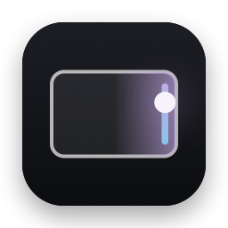
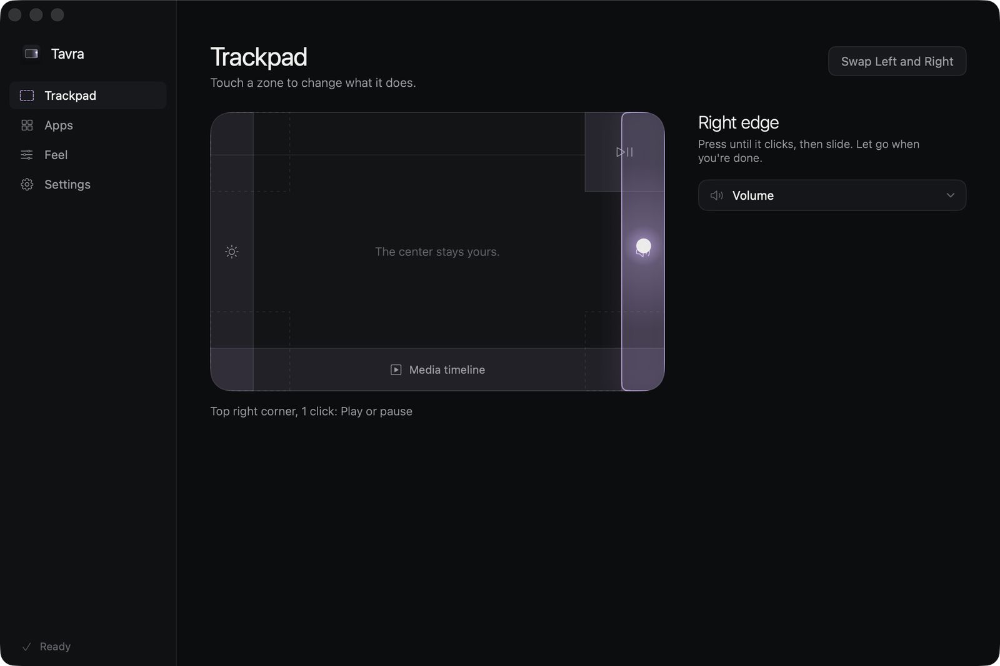
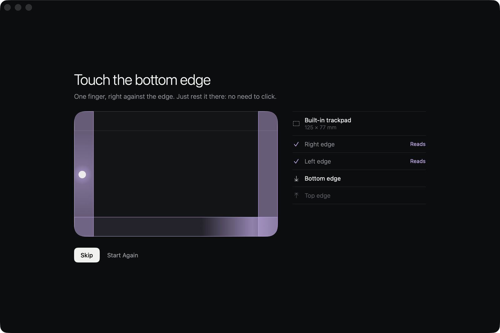
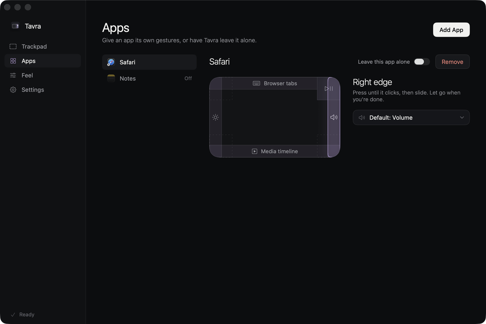
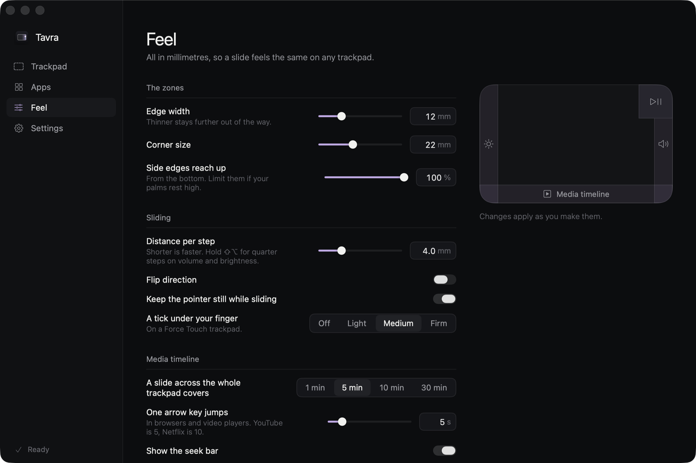

<p align="center">
  
</p>

<h1 align="center">Tavra</h1>

<p align="center">Make every touch do more.</p>

<p align="center">
  
  
  
</p>

<p align="center">
  The edges and corners of your Mac's trackpad become controls you can feel. The center stays yours.
</p>

<p align="center">
  
</p>

> [!NOTE]
> **Tavra is new, and there's no download yet.** The gesture logic is tested, and so is the app with a scripted finger. Pressing real volume keys and holding back real clicks needs Accessibility permission, and that hasn't been confirmed on a real Mac yet. For now you [build it yourself](#build).

## Press, then slide

Press an edge until the trackpad clicks, then slide. Each edge can do any of these, and so can a corner's clicks:

| | |
|---|---|
| **Edges** | Volume, brightness, keyboard light, a media timeline, or a key for each step: browser tabs, zoom, undo and redo, desktops, or your own. |
| **Corners** | One to four clicks, each with its own job: play, mute, next track, press keys, open an app, a link or a folder, or run a Shortcut. |

Out of the box the right edge is sound, the left is light, the bottom is what's playing, and the top right corner plays and skips. Everything else is free until you want it.

## It starts by checking

Before asking for anything, the welcome guide finds your trackpad and walks you round its edges, lighting each one as it reads. Reading a finger's position needs no permission, and nothing gets clicked.

<p align="center">
  
</p>

## A set for each app

Tabs on the top edge in your browser, zoom on the right edge in a design tool, nothing at all in a game. An app can change any zone and keep the rest, or have Tavra leave it alone.

<p align="center">
  
</p>

## Tuned by feel

Edge width, corner size and step distance are all in millimetres, so a slide feels the same on any trackpad. A tick under your finger at each step, a pointer that stays put while you slide, quarter steps with ⇧⌥, and a key to hold if you'd rather ask first.

<p align="center">
  
</p>

## Staying out of the way

Only a physical click, with one finger that landed inside a zone and is still there, starts anything. Every other click goes straight through: tap-to-click, two fingers, a palm, a mouse, a finger that slid in from the middle, and anything with ⌘ or ⌃ held. A gesture that goes silent lets go by itself, and the pointer always comes back. One switch in the menu bar pauses all of it.

## The media timeline

macOS keeps its now-playing information to itself, so Tavra only uses what's open to any app:

- **Music and Spotify** are asked for the position over AppleScript, and jump to the exact second. macOS asks for permission once for each.
- **Browsers and video players** get left and right arrow keys, as precise as the player makes them.
- **Anywhere else**, it does nothing, because an arrow key would only move a text cursor.

## Permissions and privacy

Reading finger positions needs no permission. Accessibility is needed to press keys and to keep edge clicks out of apps. Tavra never listens to the keyboard, and doesn't use the network at all.

It reads touches through MultitouchSupport, a private macOS framework, so it can't be in the App Store, and a macOS update could change how that works.

## Build

You need Xcode 16 or later, and a code signing certificate so macOS remembers the permission between builds. An Apple Development certificate will do.

```sh
./scripts/test.sh       # the logic, nothing on the Mac touched
./scripts/build.sh      # build/Build/Products/Debug/Tavra.app
./scripts/e2e.sh        # the app with a scripted finger, and no real clicks
```

Debug builds take `-TavraFake YES`, which sends nothing to the system, with `-TavraDemo YES`, `-TavraCheckDemo 4`, `-TavraPage feel`, `-TavraStep check` and `TAVRA_HOME`.

## License

[MIT](LICENSE). Issues and pull requests are welcome, and reports from other Macs and trackpads help most of all.
